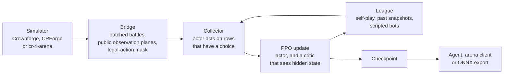

# crownforge-bot

A neural-network agent for Clash Royale battle simulators, with the self-play
training system that produces it.

The agent plays any deck against any deck. It sees only what a player sees and
outputs one simulator action per decision. It was built for the
[Crownforge](https://github.com/elicpeter/crownforge) simulator, also trains on
[CRForge](https://github.com/voonhous/crforge) and
[cr-rl-arena](https://github.com/ilumn/cr-rl-arena), and enters the cr-rl-arena
tournament under the name `ezgg`.

| | |
|---|---|
| **Network** | Separate actor and critic, 8.9M parameters in the tournament entry. Attention over units, a 16 x 9 board image, and a two-step action: what to play, then where. No recurrent memory. |
| **Training** | PPO self-play in a league: the agent itself, its own past snapshots, scripted bots, and counter policies trained only to beat it. |
| **Longest run** | 24,516 updates in 145.5 hours on one RTX 5070 Ti, about 2.4 billion decision steps. |
| **Play time** | Optional look-ahead in the real engine before each move. |
| **Stack** | Rust simulator bridges (PyO3), Python 3.11+, PyTorch. |

## Contents

- [Tournament entry](#tournament-entry)
- [Results](#results)
- [How it works](#how-it-works)
- [Simulators](#simulators)
- [Getting started](#getting-started)
- [Usage](#usage)
- [Documentation](#documentation)
- [Repository layout](#repository-layout)
- [Status](#status)

## Tournament entry

The bot this repository enters in the
[cr-rl-arena](https://github.com/ilumn/cr-rl-arena) tournament is defined by
four settings. They are the best configuration measured, and each one matters:
run it with exactly these.

| Setting | Value |
|---|---|
| Name | `ezgg` |
| Weights | `arena-it24500.pt`, the newest snapshot in the release [`arena-weights-2026-11-17`](https://github.com/elicpeter/crownforge-bot/releases/tag/arena-weights-2026-11-17). Always the one with the highest number, not an older one. |
| Deck | `executioner,archers,dart_goblin,zap,goblins,royal_ghost,mighty_miner,elixir_golem` |
| Look-ahead | `--search scope=all,cells=1,weight=20,depth=5,rollout_temperature=0.5,budget=0.6` |

After the build and the download of the weights, the whole entry is one
command (`wss://HOST` is the tournament server):

```sh
python -m cfbot.arena_client wss://HOST ezgg \
    --checkpoint weights/snapshots/arena-it24500.pt \
    --deck executioner,archers,dart_goblin,zap,goblins,royal_ghost,mighty_miner,elixir_golem \
    --search scope=all,cells=1,weight=20,depth=5,rollout_temperature=0.5,budget=0.6 \
    --log matches.jsonl
```

Three things to check before the bracket is drawn:

1. The client's first line names `arena-it24500.pt`. An older snapshot is a
   weaker bot.
2. The command has `--search` with `weight=20`. Without `--search` the bot
   plays without look-ahead, which scored lower against the strongest
   opponent it was tested on (0.52 against 0.60).
3. `ezgg` is in the pool on `https://HOST/tournament`, and the client stays
   running until the tournament is over. A bot that is not connected when the
   bracket is drawn is not in it.

Where to go from here:

- **The steps**, from an empty folder to a playing client (build, download
  with checksums, a local check, what to watch while it plays):
  [docs/arena-how-to-enter.md](docs/arena-how-to-enter.md).
- **With Claude Code**: open this repository and ask it to enter the arena
  tournament. The skill in
  [.claude/skills/enter-arena-tournament](.claude/skills/enter-arena-tournament/SKILL.md)
  follows the same steps with the same settings.
- **What the bot is**, how it was trained and what was measured:
  [docs/arena-model-and-training.md](docs/arena-model-and-training.md).

## Results

All from the arena run that produced the entry. A score is the share of games
won, a draw counting half, from seat-swapped pairs of games.

Rating on the run's own scale, where 0 is the same network with random weights
and a difference of 100 points is a score of 0.64:

| Iteration | 0 | 200 | 3850 | 10000 | 17700 | 24500 |
|---|---|---|---|---|---|---|
| Rating | 0 | +513 | +945 | +1327 | +1669 | +1756 |

The snapshot of iteration 24350, which rates level with the entry, on the
tournament deck (512 games per row unless said, each row ±0.04):

| Opponent | Without look-ahead | With look-ahead |
|---|---|---|
| Counter policy trained to beat the bot on its own deck | 0.518 | 0.596 |
| Counter policy trained to beat it with four attacking decks | 0.802 | 0.826 |
| Counter policy trained to beat it with the pool decks | 0.832 | 0.813 |
| Its own copy without look-ahead, eight focus decks (1,024 games) | 0.636 | 0.683 |

In the last updates of the training log, on its training mix of decks, it
scored 0.99 against the arena's example agent and 0.99 against a random
player.

Every number here is against the bot itself, its past versions, policies
derived from it or scripted bots. It has not played another team's bot. The
full tables, the reading of them and what is not known are in
[docs/arena-model-and-training.md](docs/arena-model-and-training.md).

## How it works



- **Observation.** A bridge steps many battles in parallel and writes arrays
  for both players: units and towers, hand, decks, the last 32 card plays and
  the opponent's revealed cards. It adds what a memory-less policy could not
  otherwise know, such as the card cycle of both sides and the opponent's
  elixir counted from what both players can see.
- **Network.** Units become tokens that attend to each other and are scattered
  onto a 16 x 9 board image. Seven query tokens read everything else through
  cross-attention. A pointer picks waiting, a card or an ability; the chosen
  card's query then picks one of 576 tiles. The simulator's own legality masks
  apply to both steps.
- **Training.** PPO over a league of opponents. The critic is a separate
  network that also sees the opponent's hidden state, so it exists only in
  training. The reward is +1 for a win and -1 for a loss, plus shaping terms
  that anneal to zero over the first quarter of a run.
- **Look-ahead.** On the arena simulator the client can play each candidate
  move forward in the real engine and let the value head score the positions
  reached, before it sends one.

The design and its reasons are in [docs/design.md](docs/design.md). The network
of the tournament entry, with diagrams, is in
[docs/arena-model-and-training.md](docs/arena-model-and-training.md).

## Simulators

The network, the collector, the league and the evaluation are the same code on
all three; only the environment differs. A model is tied to the simulator it
was trained on, and a checkpoint remembers which one that was.

| `simulator=` | Engine | Bridge | Reference |
|---|---|---|---|
| `crownforge` (default) | [Crownforge](https://github.com/elicpeter/crownforge), Rust | [src/](src), built with maturin | [docs/design.md](docs/design.md) |
| `crforge` | [CRForge](https://github.com/voonhous/crforge), a Java battle core held tick for tick to battles recorded in the game | [java/](java), through JPype | [docs/crforge-simulator.md](docs/crforge-simulator.md) |
| `arena` | [cr-rl-arena](https://github.com/ilumn/cr-rl-arena), the Rust engine of the agent tournament | [arena/](arena), compiled from the engine's source at a pinned commit | [docs/arena-simulator.md](docs/arena-simulator.md) |

## Getting started

Requires a Rust toolchain, Python 3.11 or later and PyTorch.

### Crownforge

The simulator is found through a symlink named `sim`, which is not checked in:

```sh
ln -s /path/to/crownforge sim        # a crownforge checkout
python3 -m venv .venv --system-site-packages && source .venv/bin/activate
pip install maturin pytest
maturin develop --release            # builds the Rust bridge into the venv
python -m pytest -q
```

Developed against crownforge `9d5bff4e`. Rebuild with `maturin develop --release`
after the simulator or anything under `src/` changes, then run the tests: they
compare the bot's public planes against the simulator's hidden state.

### cr-rl-arena

Needs no Crownforge checkout. In an environment that already has PyTorch:

```sh
scripts/setup_arena.sh                                               # macOS, Linux
powershell -ExecutionPolicy Bypass -File scripts\setup_arena.ps1     # Windows
```

The script fetches the engine at the pinned commit and builds the bridge to
it. `ARENA_REV` selects another commit. Details are in
[docs/arena-simulator.md](docs/arena-simulator.md).

### CRForge

Needs Java 21 and game tables that CRForge builds from the game's own files.
The steps are in [docs/crforge-simulator.md](docs/crforge-simulator.md#setup).

## Usage

### Train

```sh
python -m cfbot.train --run runs/main --set budget_hours=330   # start a two-week run
python -m cfbot.train --run runs/main --resume                 # continue after a stop
scripts/run_forever.sh runs/main --set budget_hours=330        # restart after crashes
```

Ctrl-C checkpoints and exits. A checkpoint holds the model, its averaged
weights, the optimizer, the league and the deck statistics, and a run directory
can be moved between machines: a run started on Apple Silicon continues on an
NVIDIA GPU with `--resume`. The model size is fixed when a run starts
(`--preset small|base|large`); every other setting can change on resume with
`--set key=value`. [config.py](python/cfbot/config.py) lists them all. Add
`--set simulator=arena` or `--set simulator=crforge` for the other simulators.

The metrics to watch, the schedules, the throughput on Apple and NVIDIA GPUs
and one difference between those devices that affects a moved run are in
[docs/training.md](docs/training.md).

### Evaluate

```sh
python -m cfbot.evaluate --ratings runs/main                       # rating of every gauntlet so far
python -m cfbot.evaluate runs/main/checkpoint.pt random --pairs 200
python -m cfbot.evaluate A.pt B.pt --ema                           # averaged weights
```

A direct comparison plays each deck pair twice with seats swapped and the same
seed. During a run the agent also plays a fixed gauntlet every 2% of the run,
and one rating scale is fitted over all of its results; see
[docs/training.md](docs/training.md#measuring-strength).

### Use a trained agent

```python
from cfbot.agent import Agent
from cfbot.env import Env

env = Env(num_envs=1)
agent = Agent.load("runs/main/checkpoint.pt", env.spec, seed=0)
obs = env.reset(seed=7)
while True:
    actions = agent.act(obs)          # one flat action index per player row
    obs, info = env.step(actions)
    if info["done"][0]:
        break
```

`Agent` reads only public planes, keeps no hidden memory and is reproducible:
the same checkpoint, seed and observations give the same actions on the same
machine. It samples from the policy with a seeded generator by default.
`mode="greedy"` always takes the most likely action, but "wait" is usually the
most likely action even just before a play, so greedy play can stall.

### Export to ONNX

For a program outside Python, export the policy:

```sh
pip install onnx onnxscript onnxruntime
python -m cfbot.export runs/main/checkpoint.pt policy.onnx
```

The graph maps the public observation planes to the log-probability of all
4,611 simulator actions (`-inf` where illegal) and a value estimate. Action
indices are the ones `crownforge_train::grid::decode_observed` accepts.

The public planes are built by the bridge, which counts the opponent's plays
and elixir from what both players can see. A program that controls one seat
only has to do the same counting to feed the exported graph.

### Play on an arena server

```sh
python -m cfbot.arena_client wss://HOST NAME --checkpoint runs/arena/checkpoint.pt \
    --deck knight,archers,giant,musketeer,skeletons,fireball,arrows,zap
```

The client joins, answers every observation and plays until stopped. `--search`
adds look-ahead. The options, a local server to try a checkpoint on, and what
was measured are in
[docs/arena-simulator.md](docs/arena-simulator.md#playing-in-the-tournament).
For the tournament itself, use the settings under
[Tournament entry](#tournament-entry).

## Documentation

| Document | Contents |
|---|---|
| [docs/design.md](docs/design.md) | Observation planes, network, reward, league and decks, with the reasons; notes on the Crownforge simulator |
| [docs/training.md](docs/training.md) | Running and resuming, the metrics, measuring strength, throughput and memory |
| [docs/arena-simulator.md](docs/arena-simulator.md) | The cr-rl-arena bridge: what the policy sees, actions, decks, opponents, the client, look-ahead and what was measured |
| [docs/crforge-simulator.md](docs/crforge-simulator.md) | CRForge setup, how the bridge is put together, where its planes differ, throughput |
| [docs/arena-model-and-training.md](docs/arena-model-and-training.md) | The tournament entry: its network, how it was trained and its measured strength |
| [docs/arena-how-to-enter.md](docs/arena-how-to-enter.md) | Entering the tournament step by step, with every setting and what was measured for it |
| [docs/arena-deck-tournaments.md](docs/arena-deck-tournaments.md) | The three knockout tournaments that chose the decks of the arena run |
| [docs/arena-deck-research.md](docs/arena-deck-research.md) | Card and deck research on the arena engine |
| [docs/arena-decks.json](docs/arena-decks.json) | The deck lists the arena run uses |

## Repository layout

| Path | Contents |
|---|---|
| `src/` | Rust bridge to Crownforge: batched battles, featurizer, cycle and elixir tracker, deck sampler |
| `arena/` | Rust bridge to cr-rl-arena: the same, computed from what the tournament server sends, and the client's featurizer and look-ahead |
| `java/` | Bridge class for CRForge |
| `python/cfbot/` | Model, PPO, league, decks, training, evaluation, agent, export, arena client |
| `tests/` | End-to-end tests, and the optimized collector, update and network against frozen originals |
| `scripts/` | Arena and CRForge setup, simulator benchmark, iteration and gradient-step profilers, deck tools, restart loop |
| `docs/` | Design, training and simulator references, and the tournament entry |

## Status

- The whole pipeline runs end to end and is covered by tests: environment
  bridges, network, PPO, opponent league, paired evaluation, the training
  command with resume, and seeded play.
- The one long run is the arena run behind the tournament entry. On Crownforge
  and CRForge only runs of one to six hours have been made, so no strong model
  exists for those simulators.
- Training has run on Apple Silicon (M2 Max) and on an NVIDIA GPU under
  Windows (RTX 5070 Ti). `compile=true` did not help on Windows.
- The entry has not played another team's bot. What else is not verified is
  listed at the end of
  [docs/arena-model-and-training.md](docs/arena-model-and-training.md#what-is-not-known)
  and [docs/arena-how-to-enter.md](docs/arena-how-to-enter.md#not-verified).
