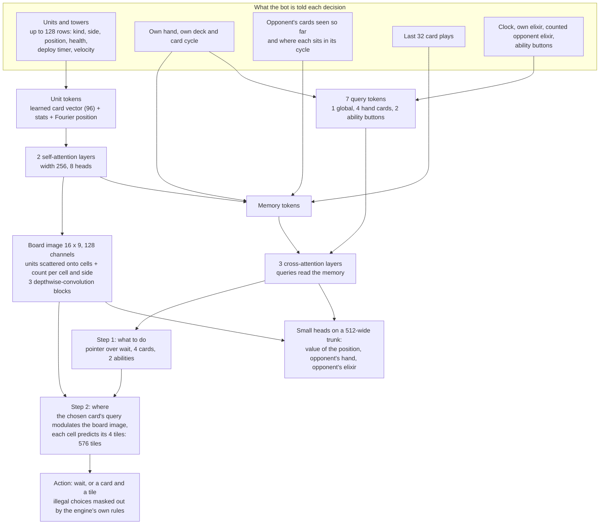
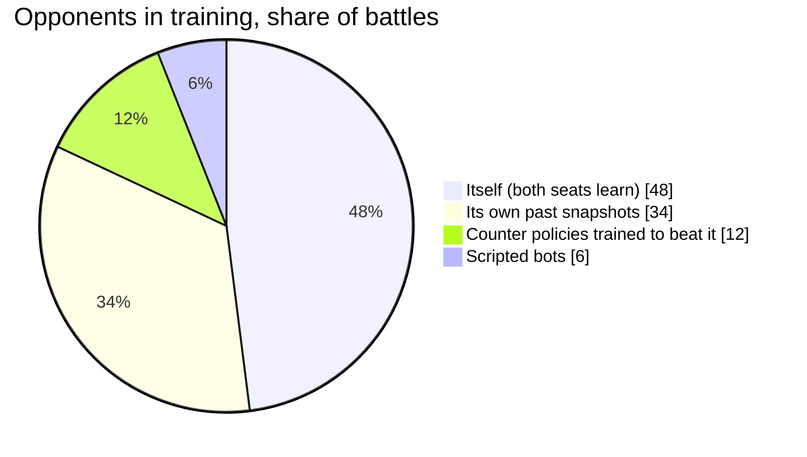
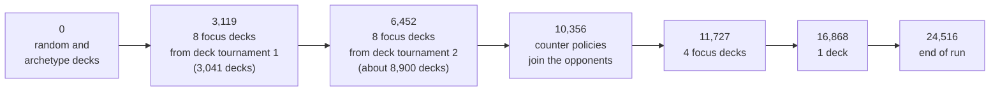
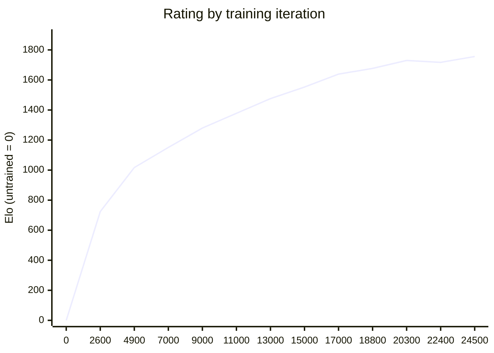
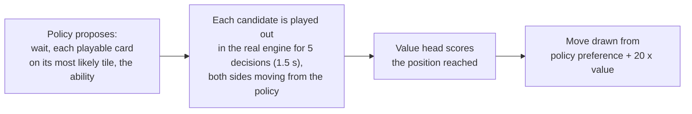

# The bot: network, training, and why it is strong

What the tournament entry `ezgg` is made of: the shape of its neural network,
the ideas its training followed, how the training run went, and what has been
measured about its strength. How to run it is in
[arena-how-to-enter.md](arena-how-to-enter.md).

Measured results and the reading of them are kept in separate sections. A
score is the share of games won, a draw counting half, from seat-swapped pairs
of games.

## In short

- One network of 8.9 million parameters, 6.2 million of them in the part that
  plays. No recurrent memory.
- Trained from random weights by self-play with PPO on the tournament's own
  battle engine: 24,516 updates over 145.5 hours of training, about 2.4
  billion decision steps.
- Its opponents in training were itself, its own past versions, scripted
  bots, and three "counter" policies trained separately for the single
  purpose of beating it.
- It plays one deck: the winner of a knockout among about 8,900 candidate
  decks, kept after a second search over 9,100 variations, and practised
  alone for the last third of the run.
- At play time it looks 1.5 seconds ahead in the real engine before each
  move.
- On the run's own rating scale it went from 0 (untrained) to +1756.

## The network

### The part that plays (actor, 6.2M parameters)

1. **Tokens.** Every visible unit and tower becomes one token: a learned
   vector for its card, its static stats, and its position as Fourier
   features. Two self-attention layers (width 256, 8 heads) let units see each
   other.
2. **A board image.** The same tokens are added into a 16 x 9 grid of cells
   with 128 channels, together with a count of units per cell and side, and
   refined by three depthwise-convolution blocks. This is where "what is
   near what" lives.
3. **Seven queries.** One global token, one per hand card and one per ability
   button read everything else through three cross-attention layers: the
   units, both decks, the opponent's revealed cards and the last 32 plays.
   Seven queries reading a memory costs a fraction of full self-attention
   over every token (the Perceiver layout).
4. **A two-step action.** First a pointer chooses among waiting, the four
   hand cards and the abilities. Then the chosen card's query modulates the
   board image, and each of the 144 cells predicts its four tiles: one of 576
   tiles. A small per-card table adds an exact-tile prior. The engine's own
   legality rules mask both steps, so the network cannot choose a move the
   server would refuse.

### No memory, on purpose

The network sees one moment and has no recurrent state. Everything a player
has to remember is computed and put in the input instead: the opponent's
elixir counted from what it has played, which of its cards have been seen and
where each sits in the four-card cycle, the recent plays, how long each unit
has been out and how fast it moves. A network without memory is cheaper to
train, cannot forget, and gives the same answer for the same position, which
is what makes look-ahead at play time possible.

### The part that only trains (critic, 2.7M parameters)

A separate, smaller network with its own embeddings (width 192) predicts the
outcome of the game. It is also shown the opponent's true hand, deck and
elixir, which the playing part never sees. It exists only in training and is
not used in the tournament. It predicts a distribution over 61 outcome bins
rather than one number.

The playing part keeps three small heads of its own: a value estimate from
public information (used by the look-ahead), a guess of the opponent's hand,
and a guess of its elixir. They send only a tenth of their gradient back into
the encoder, so they inform it without competing with the policy.

### Sizes

| | |
|---|---|
| parameters | 8.9M in all: 6.2M actor, 2.7M critic |
| width | 256, 8 attention heads |
| unit self-attention layers | 2 |
| query cross-attention layers | 3 |
| board image | 16 x 9 cells, 128 channels, 3 convolution blocks |
| card vector | 96 |
| actions | wait, 4 cards x 576 tiles, abilities |
| decision rate | every 6 ticks (0.3 s of game time) |
| time per move | about 25 ms on a laptop CPU without look-ahead |

## Training philosophy

Six ideas, each with what was done about it.

**1. Train on the real thing.** The training environment compiles the
tournament engine's own source files at the commit the server runs, so a
battle in training is the battle the server plays. The bot's inputs are built
from exactly what the server's message contains, by the same code in training
and in the tournament client; a test plays whole battles both ways and
requires every input of every decision to be bit-identical. Nothing has to
transfer.

**2. A small, fast network on very many games.** Rather than a large model,
a model small enough to play 1,536 battles at once: about 2.4 billion
decision steps in 145.5 hours, on the order of ten million finished battles
(about 400 per update late in the run).

**3. Put memory in the input, not in the network.** See above.

**4. Reward winning, and only at first anything else.** +1 for a win, -1 for
a loss. Three shaping terms (tower health, the elixir value of trades, elixir
wasted at the cap) help the first steps and are annealed to zero over the
first quarter of the run, so the finished bot was optimising wins alone.

**5. Many kinds of opponent, weighted towards the ones it still loses to.**
A bot that only plays itself learns to beat itself. The mix at the end of
the run:

- Past snapshots are drawn mostly by how often the bot still loses to them.
- The three counter policies were separate training runs. Each started from
  the bot's own weights and trained against a frozen copy of the bot, with
  nothing to do but find what beats it: one with decks built to attack it,
  one with the general deck pool, one mirroring its own decks. About twice a
  day the newest counters were swapped into the bot's league and the counters
  were re-aimed at the newest bot.

**6. Find the deck by measurement, then specialise.** A tournament entry
plays one deck. The run started on random and archetype decks, then:

In a deck tournament one snapshot of the bot pilots every candidate deck on
both seats; half the field is dropped each round and the survivors play more
games. A third tournament over about 9,100 decks, most of them variations of
the second's best, did not replace its winner. Each cut (eight decks to four, to two, to one) was decided by playing
the candidates against the bot on other decks and against the three counter
policies. The opposing side was never narrowed: the bot kept meeting the
whole pool of decks.

### The update

PPO, one pass over each batch of 1,536 battles x 64 decisions, with a
separate critic that sees hidden information. Learning rate from 2e-4 down to
2e-5 and entropy bonus from 0.01 down to 0.003, both along a cosine. Rewards
are discounted by game time, and a step skips ahead while neither player can
do anything but wait. Decisions where waiting was the only legal move carry
no policy gradient.

## How the run went

Ratings on the run's own scale: 0 is the same network with random weights,
and a difference of 100 points is a score of 0.64. Each snapshot played the
one before it and the one two before it, 1,024 games a match, 57,344 games
in all.

| iteration | rating | |
|---|---|---|
| 0 | 0 | untrained |
| 200 | +513 | |
| 3100 | +617 | last before focus decks |
| 3850 | +945 | |
| 6000 | +1073 | pilot of deck tournaments 2 and 3 |
| 10000 | +1327 | |
| 14450 | +1527 | |
| 17700 | +1669 | |
| 20300 | +1730 | |
| 24350 | +1750 | |
| 24500 | +1756 | the entry |

Up to 14450 the matches were played on the eight focus decks, after that on
the tournament deck alone. Every rated match is within 0.03 of the score the
ratings predict. One match carries about 20 points of error, so 22400 rating
13 below 20300 is not a real step back. The full tables are in the notes of
the GitHub release that holds the weights.

The gain slowed at the end: about +44 points per 1,000 iterations from 14450
to 17700, about +13 per 1,000 after that.

## Look-ahead at play time

The trained network alone answers in about 25 ms. The entry spends some of
the server's two seconds per move on thinking:

All candidates of one decision share the same random draws, so two
candidates differ by what the move changes and not by luck. A time cap of
0.6 s stops a slow decision early instead of letting it arrive late. On a
laptop CPU a decision takes 150 to 250 ms.

The engine the look-ahead runs is rebuilt from what the server shows, which
is not everything: spells in flight, status effects and the opponent's hand
are not sent. The opponent in the imagined future holds the cards it has
shown, filled up with a guess, and is played by the same network.

## Strength: what was measured

All with the snapshot of iteration 24350 (level with the entry, 24500) on the
tournament deck, sampled play, 512 games per row unless said, none crashed.
Each row is ±0.04.

| opponent | score without look-ahead | with look-ahead |
|---|---|---|
| counter c: trained to beat the bot on its own deck, newest copy | 0.518 | 0.596 |
| counter a: trained to beat it with four attacking decks, newest copy | 0.802 | 0.826 |
| counter b: trained to beat it with the pool decks, newest copy | 0.832 | 0.813 |
| its own copy on the eight focus decks, without look-ahead (1,024 games) | 0.636 | 0.683 |

From the last updates of the training log, where the bot plays its training
mix of decks: 0.99 against the engine's example agent (`rush`, a card on a
random tile whenever it can afford one), 0.99 against a random player, and
0.95 and 0.98 against the two scripted lane bots.

Against its own earlier versions, on the tournament deck (1,024 games each):
24500 scored 0.566 against 22400; 20300 scored 0.607 against 17700. An
earlier snapshot (17050) scored 0.89 against iteration 12000 and 0.95 against
iteration 8000.

The counters measure something the ratings cannot: how much is left to
exploit. The mirror counter's own training score against the frozen copy of
the bot it was aimed at, some hours after being aimed: about 0.85 against
iteration 10150, 0.83 against iteration 11700, and 0.61 to 0.64 against
iteration 22400. In the matches of the table above, the newest mirror
counter, after about 100 hours of training aimed at nothing but this bot,
scores 0.48 against the bot without look-ahead and 0.40 against it with.

## Why we think it is strong

This section is our reading, not a measurement.

- **Nothing is lost between training and the tournament.** Same engine, same
  inputs bit for bit, same legality rules. Many bots lose strength at this
  seam; this one was built so that there is no seam.
- **It has played a great deal.** About ten million battles is far more than
  a larger network could have played in the same time, and in a game with
  few, costly decisions the number of games matters more than the size of
  the model.
- **Its weaknesses were hunted, not waited for.** Self-play finds only the
  weaknesses the bot itself stumbles into. The counter policies had one job,
  and the bot trained against whatever they found, for 14,000 iterations.
  The result is the last paragraph of the section above: a dedicated
  adversary that used to win five games in six now gets between an even game
  and three in five.
- **It is a specialist.** The deck was chosen by measurement out of
  thousands of candidates, and the last third of the run practised that deck
  alone against the whole pool of opposing decks.
- **It thinks before it moves.** The look-ahead uses the real engine, and it
  gains most exactly where the network is weakest: +0.08 against the
  adversary trained to beat it.
- **It does not depend on remembering.** The inputs carry the opponent's
  elixir and card cycle explicitly, so the bot knows when the answer to its
  push is out of the opponent's hand.

## What is not known

- It has never played another team's bot. Every number here is against
  itself, its past versions, policies derived from it, or scripted bots.
- The ratings compare snapshots of this run with each other. They say
  nothing about a bot from elsewhere.
- It plays one deck. Against a deck or a style that neither the pool nor the
  counters ever produced, nothing has been measured.
- A spell that leaves no unit is not shown by the server, so the bot does not
  see it being played and its count of the opponent's elixir can be wrong.
- The look-ahead settings were chosen against its own copy and the counters.
  The differences between the settings tried are inside the error of single
  matches.
